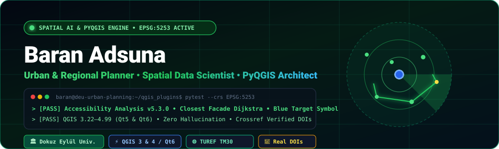
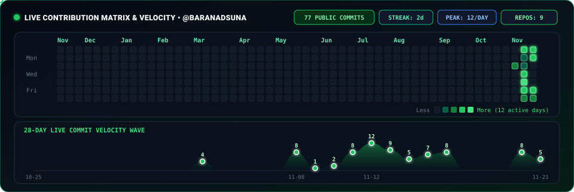

<!-- Custom Glowing Green Spatial AI & Urban Network Animated Hero Banner -->

 

  
  
  
  

  
  
  
  

### 🐍 Live Animated Contribution Graph & Velocity Wave

<!-- Live Glowing Green Contribution Snake (Auto-updated every 6h by GitHub Actions) -->
<picture>
  <source media="(prefers-color-scheme: dark)" srcset="https://raw.githubusercontent.com/baranadsuna/baranadsuna/output/github-snake-dark.svg" />
  <source media="(prefers-color-scheme: light)" srcset="https://raw.githubusercontent.com/baranadsuna/baranadsuna/output/github-snake.svg" />
  
</picture>

<!-- Live Glowing Green Contribution Matrix & 28-Day Commit Velocity Wave -->
<picture>
  <source media="(prefers-color-scheme: dark)" srcset="https://raw.githubusercontent.com/baranadsuna/baranadsuna/output/contrib-pulse-dark.svg" />
  <source media="(prefers-color-scheme: light)" srcset="https://raw.githubusercontent.com/baranadsuna/baranadsuna/output/contrib-pulse-light.svg" />
  
</picture>

### 🌟 Featured Live Showcase: Accessibility Analysis (`v5.3.0`)

  
   
  

### 🚀 About Me & Academic Vision

I am an undergraduate researcher and developer at **Dokuz Eylül University, Faculty of Architecture — Department of Urban and Regional Planning** (İzmir, Turkey). I bridge urban planning theories (*15-minute city walkability catchments, closest road-facing facade network routing, Nolli figure-ground morphology, MPYY zoning standards, and 3D disaster vulnerability*) with modern **computational spatial data science**, **topological network graphs**, and **production-grade PyQGIS plugin engineering**.

> *"Urban planning is not merely drafting visual layouts on a map; it is a mathematically rigorous, auditable, and spatial equity-driven science."*

Guided by this academic ethos, I build robust, high-performance tools compatible with **QGIS 3 & QGIS 4 (Qt5 & Qt6)** that compress weeks of manual planning workflows into single-click deterministic spatial algorithms and executive-ready reports.

### 🛡️ Immutable Academic & Engineering Laws (The 5 Golden Rules)

Every repository, algorithmic pipeline, and plugin under this profile is bound by five strict governance principles:

| # | Principle | Description & Enforcement |
| :---: | :--- | :--- |
| **1** | **🎯 Zero Hallucination** | No synthetic, fabricated, or AI-generated dummy spatial layers. Every metric is computed against real geometries and deterministic spatial math. |
| **2** | **📜 Real DOI Requirement** | Every academic reference cited across plugins, reports, and documentation is verified via Crossref & DOI.org APIs. |
| **3** | **🔗 No Orphan Analysis** | Every spatial analysis must feed directly into a planning synthesis (e.g. vulnerability matrix, accessibility index) or justify its omission. |
| **4** | **🌐 CRS Standard: EPSG:5253** | All geometries, network distances, and area calculations strictly execute within the Turkish National Reference Frame (TUREF / TM30). |
| **5** | **🧠 Creative Responsibility** | While computational backends are shared, planning interventions, weighting coefficients, and policy thresholds reflect individual intellectual judgment. |

### 🏛️ Flagship QGIS Plugins & Spatial Engineering Suite

| Plugin & Repository | Capabilities, Architecture & Impact | Technical Badges |
| :--- | :--- | :--- |
| **🎯 [Accessibility Analysis (yesil_alan_erisimi)](https://github.com/baranadsuna/yesil_alan_erisimi)** *Urban Network Accessibility, Closest Facade Snapping &amp; Pedshed Suite (v5.3.0)* | • **Closest Road-Facing Facade Snapping:** Evaluates every `5 m` facade point along residential blocks and connects from the facade facing the shortest street path to the target facility (schools, parks, healthcare, transit). • **Prominent Blue Target Facility Symbology (`#2563EB`):** Renders target facilities as high-contrast `5.6 mm` Blue Circle markers at the top of the layer tree. • **Colored Block Polygons &amp; Clean Isochrones:** Paints reached blocks in vibrant Green (`0–250 m`), Amber (`250–500 m`), and Red (`>500 m`) with non-overlapping walkability bands and automatic T-junction gap healing. • **100% English Default + 5-Language UI:** Instant runtime switching across English, Turkish, Simplified Chinese, Spanish, and Indonesian. |     |
| **🗂️ [layer_tree_packager](https://github.com/baranadsuna/layer_tree_packager)** *Hierarchical Layer Packager &amp; GeoPackage Tree Suite (v1.1.1)* | • **Zero-Loss Hierarchy Preservation:** Packages multi-layer GIS trees into single `.gpkg` containers without flattening group nesting. • **Automated Drag-and-Drop Restoration:** Intercepts `.gpkg` file drops via `QgsCustomDropHandler` to reconstruct groups, ordering, and styles in under 1 second. • **Dynamic 6-Language Support:** Instant switching across English, Turkish, German, French, Spanish, and Portuguese. • **Layer Edit Mode Safeguard:** Real-time detection and lockout protecting uncommitted layer edits from corruption. |     |
| **🏙️ [AkilliBolgelemeAraci](https://github.com/baranadsuna/AkilliBolgelemeAraci)** *Urban Zoning &amp; Disaster Vulnerability Suite (v1.9.2)* | • **9 Strategy Presets &amp; Tab 6 Custom Zones:** Organic valley corridors, active fault/flood buffers, vacant land growth, and independent pre-zoned boundary audits. • **3D Disaster Vulnerability:** Exposure ($E$), Sensitivity ($S$), Adaptive Capacity ($AC$) synthesis. • **Smart Population Engine:** Building footprint &amp; floor-weighted residential block disaggregation. • **Executive Reporting:** Automated 5-sheet Excel (`.xlsx`) with `0_Lejant_Sentez_Metinleri` narratives. |     |
| **📐 [doluluk_bosluk_analizi](https://github.com/baranadsuna/doluluk_bosluk_analizi)** *Figure-Ground &amp; Building Coverage Analyzer (v1.2.2)* | • **Urban Morphology &amp; Nolli Analysis:** Precise solid-void ratio and Building Coverage Ratio (BCR / TAKS). • **High Performance:** $O(\log N)$ spatial indexing powered by native `QgsSpatialIndex`. • **Adaptive Thematic Symbology:** 5-class Urban Heatmap, Nolli Monochrome, and Eco-Traffic. • **Quad-Lingual Interface:** Real-time live language switching across English, Turkish, Chinese, and Indonesian. |     |
| **🏛️ [mpyy_donati_analiz](https://github.com/baranadsuna/mpyy_donati_analiz)** *MPYY Annex-2 Infrastructure Compliance (v2.1.0)* | • **Regulatory Standard Audit:** Computational verification of Turkish Spatial Plans Regulation (MPYY Annex-2, including Kindergarten/Nursery). • **E2SFCA Deficit-Weighted Dijkstra Graph:** Network accessibility &amp; capacity relief across schools, health centers, religious and park facilities. • **Smart Parcel Splitter:** 12-step *Binary Polygon Splitting* with isolated `Onerilen_Konut_Adalari` equilibrium screening. |     |
| **🤖 [01_qgis_lite_agent_mcp](https://github.com/baranadsuna/01_qgis_lite_agent_mcp)** *AI Agent &amp; Model Context Protocol Bridge* | • **GeoAI Agent for PyQGIS:** Local Model Context Protocol (MCP) server enabling safe LLM-to-GIS loopback. • **AST Security Sandbox:** Pre-flight AST validation preventing dangerous arbitrary code execution. • **Graphical Model Synthesis:** Converts natural language spatial instructions directly into native `.model3` workflows. |     |

### 💻 Computational & Spatial Technology Stack

#### 🛠️ Core Languages & Runtime Frameworks

  

#### 🌍 Geospatial & Data Science Ecosystem

  
  
  
  
  
  
  
  
  
  

### 📈 Live GitHub Activity & Analytics

  
  

  

---

### 🤝 Connect & Collaboration

Interested in collaborating on spatial algorithms, urban analytics, or PyQGIS plugin development? Feel free to connect:

  
  
  

<i>"Designing cities not by intuition alone, but empowered by spatial data, reproducible science, and spatial justice."</i> 🏛️📐⚡

 

